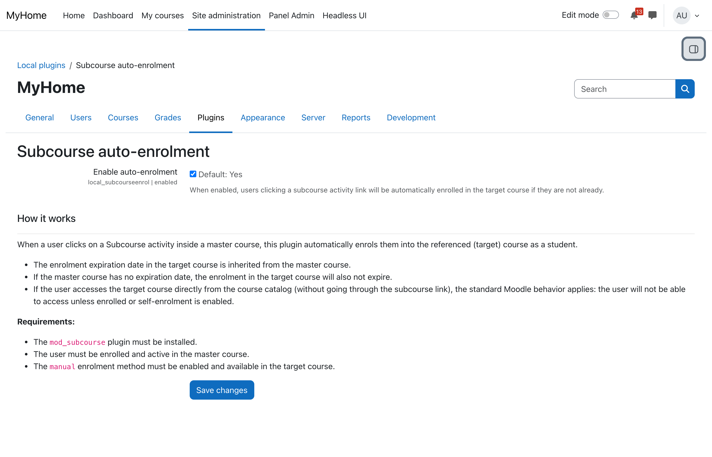
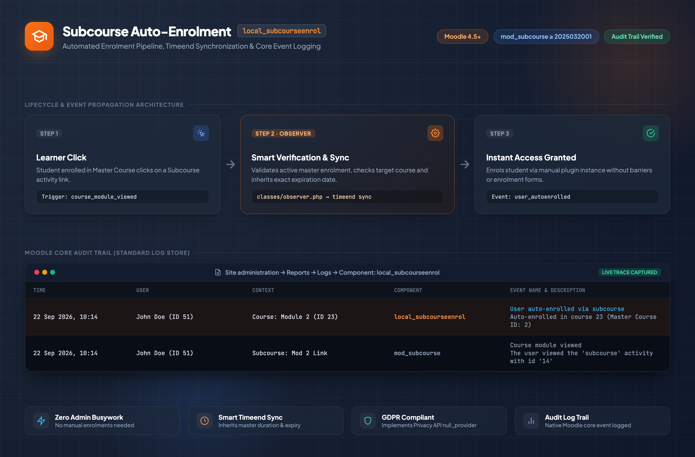

# 🎓 Subcourse Auto-Enrolment — `local_subcourseenrol`

> **Moodle Local Plugin** · v2.1.6 (build `2026111900`, 2026-11-19) · Requires Moodle 4.5+ (tested with Moodle 5.3, compatible with Moodle 4.5–5.3) · Requires `mod_subcourse` ≥ 2025032001

**Subcourse Auto-Enrolment** bridges the gap between structured learning pathways and administrative simplicity. It automatically enrols students into target courses the moment they click on a Subcourse activity, syncing enrolment expiration effortlessly from the master course.

---

## ✨ Why Subcourse Auto-Enrolment?

Managing complex training programs across multiple Moodle courses can be an administrative nightmare. This plugin automates the busywork:

- **Seamless Learner Journey** — Students click a subcourse link and gain instant access. No frustrating _"You cannot enrol yourself in this course"_ errors.
- **Smart Access Expiration & Renewal** — Enrolment duration in the target course dynamically mirrors the master course (`timeend` inheritance). If a prior enrolment has expired, navigating from the master course renews it. Perpetual enrolments (no expiry) are fully preserved.
- **Suspension Safety (Cross-Method)** — Explicitly suspended enrolments in the target course (`ENROL_USER_SUSPENDED`) across any enrolment method are respected and never overridden automatically.
- **Session & Target Guards** — Automatically skips "Login as" (`is_loggedinas()`) sessions, `SITEID`, self-referential subcourses, and deleted/suspended users.
- **Deterministic Instance Selection** — Always selects the active, enabled manual enrolment method with the highest priority (`sortorder, id ASC`).
- **Admin Relief** — Say goodbye to manual enrolments or complex cohort sync setups for subcourses.
- **Audit Trail** — Every auto-enrolment fires a custom Moodle event (`\local_subcourseenrol\event\user_autoenrolled`) visible in the site log.
- **GDPR Compliant** — Implements the Privacy API `null_provider`; no personal data is stored.

---

## 🛠️ Technical Architecture

| Component | Description |
|-----------|-------------|
| **Plugin type** | Local (`local_subcourseenrol`) |
| **Entry point** | `db/events.php` — registers an observer on `\mod_subcourse\event\course_module_viewed` |
| **Observer** | `classes/observer.php` — `subcourse_viewed()` |
| **Role resolver** | `classes/local/role_resolver.php` — resolves configured enrolment role or falls back to student archetype |
| **Custom event** | `classes/event/user_autoenrolled.php` — logged to Moodle's event log |
| **Privacy** | `classes/privacy/provider.php` — `null_provider` (no data stored) |
| **Settings** | `settings.php` — enable/disable toggle under _Site Administration → Local plugins_ |
| **Tests** | `tests/observer_test.php` (26 cases) · `tests/event_test.php` (5 cases) [31 PHPUnit cases total] · `tests/behat/autoenrolment.feature` (3 Behat scenarios) |

---

## 📸 Screenshots & Assets

| Admin Settings | Event Flow & Audit Trail |
|---|---|
|  |  |

Official plugin icon and marketplace assets are located in [`pix/`](pix/):
- `pix/icon.svg` — Vector plugin icon
- `pix/marketplace_icon_*.png` — Marketplace distribution assets

### Enrolment Logic Flow

```
User clicks Subcourse activity
        │
        ▼
mod_subcourse fires course_module_viewed event
        │
        ▼
observer::subcourse_viewed()
        ├─ Plugin disabled or "Login as" session? → return
        ├─ subcourse.refcourse empty, ≤ 0, SITEID, or self-referential? → return
        ├─ Target course or context missing? → return
        ├─ Master enrolment missing, inactive, disabled, or future start? → return
        ├─ Manual enrolment plugin disabled globally? → return (debugging)
        ├─ No enabled manual instance in target course? → return (debugging)
        ├─ Role resolution (roleid configured + CONTEXT_COURSE check, or fallback to archetype student) → No role? return
        ├─ Acquire concurrency lock (\core\lock\lock_config) → Failed? return
        │     ├─ User already actively enrolled in target? → release lock & return
        │     ├─ Existing target enrolment explicitly suspended (any method)? → release lock & return (preserve status)
        │     ├─ enrol_user(instance, userid, roleid, masterTimestart, masterTimeend) [renews if expired]
        │     └─ Fires user_autoenrolled event
        └─ Release lock
```

**`timestart` & `timeend` inheritance & renewal:**
- The observer inspects `user_enrolments` in the master course and selects the most permissive active enrolment — perpetual (`timeend = 0`) is prioritised over any expiring enrolment.
- Both `masterTimestart` and `masterTimeend` are inherited directly from the master course enrolment into the target course.
- If the learner was previously enrolled in the target course but their enrolment expired, access is renewed and synced to the master course's active dates.
- Explicitly suspended enrolments are kept intact to uphold administrative restrictions.
- Concurrency lock via `\core\lock\lock_config` guarantees race-free execution during rapid concurrent clicks.

---

## 📋 Requirements

- Moodle **4.5+** (version ≥ `2024100700`)
- PHP **8.1+**, **8.2**, or **8.3**
- [`mod_subcourse`](https://moodle.org/plugins/mod_subcourse) ≥ `2025032001` (introduces `course_module_viewed` event)
- The **Manual enrolment** method must be enabled on each target course

---

## 🚀 Installation

1. Copy or clone this repository into your Moodle installation:
   ```bash
   # Via Git clone:
   git clone https://github.com/hetcxp/moodle-local_subcourseenrol.git /path/to/moodle/local/subcourseenrol

   # Or manually copying the folder:
   cp -r subcourseenrol /path/to/moodle/local/subcourseenrol
   ```
2. Run the Moodle upgrade script:
   ```bash
   php admin/cli/upgrade.php
   ```
3. Navigate to **Site Administration → Local plugins → Subcourse auto-enrolment** and ensure the plugin is enabled.
4. Verify that the **Manual** enrolment method is enabled on all target courses (Moodle default: enabled).

---

## ⚙️ Configuration

| Setting | Default | Description |
|---------|---------|-------------|
| `enabled` | `1` (on) | Master toggle — disabling prevents all auto-enrolments |
| `roleid` | `0` (Student archetype) | Permite elegir el rol asignado en auto-matrícula (0 default — Student archetype; fallback automático a arquetipo si no es válido) |

Settings page: `Site Administration → Local plugins → Subcourse auto-enrolment`

---

## 🧪 Running Tests & Quality Assurance

### PHPUnit Test Suite (31 test cases)
```bash
# From your Moodle root
vendor/bin/phpunit --filter local_subcourseenrol
```
*Note: Requires `mod_subcourse` to be present in the Moodle installation; tests are safely skipped otherwise.*

### Behat Acceptance Tests (3 scenarios)
```bash
# Run acceptance test scenarios for subcourse auto-enrolment
vendor/bin/behat --tags="@local_subcourseenrol"
```

### Code Style & Linter (Moodle CS)
```bash
# Verify compliance with Moodle Coding Standards
/path/to/moodle-cs/vendor/bin/phpcs --standard=moodle /path/to/moodle/local/subcourseenrol
```

---

## 📝 Changelog

See [CHANGELOG.md](CHANGELOG.md) for full release notes and version history.

---

## 🪪 License

GNU General Public License v3 or later — see [LICENSE](LICENSE).

Copyright © 2026 Héctor Eduardo Terán Canelones.
